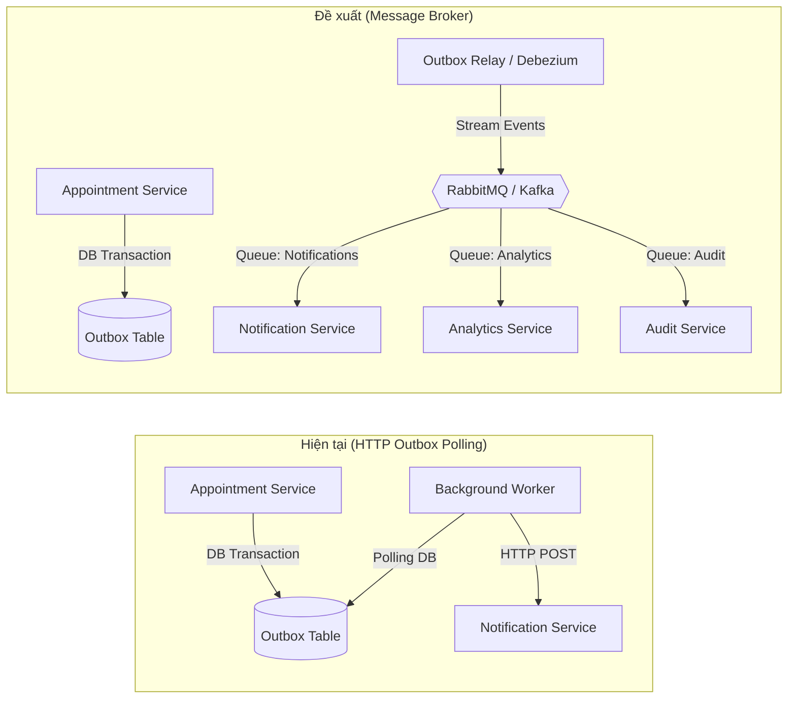

# Báo Cáo Phân Tích & Đề Xuất Cải Thiện Kiến Trúc Hệ Thống (Health&Human)

> **Tài liệu**: Báo cáo kỹ thuật đề xuất nâng cấp kiến trúc & tối ưu hóa hệ thống  
> **Dự án**: Clinic Appointment System (Health&Human)  
> **Đối tượng**: Nhóm phát triển, Tech Lead và Giảng viên hướng dẫn  
> **Ngày lập**: 15/10/2026  

---

## 1. Đặt Vấn Đề

Hệ thống đặt lịch khám bệnh **Health&Human** đã hoàn thành xuất sắc các mục tiêu cốt lõi của giai đoạn MVP (Milestone 2):
- Thiết kế chuẩn hướng dịch vụ với 6 backend services và 2 frontend riêng biệt.
- Kiến trúc **Database-per-Service** bảo đảm ranh giới dữ liệu độc lập và ngăn chặn ghép nối ngầm (coupling).
- Chống đặt trùng lịch (Double Booking) tin cậy ở tầng cơ sở dữ liệu qua PostgreSQL `btree_gist` Exclusion Constraint.
- Xử lý bất biến (Idempotency Key) và bảo đảm toàn vẹn thông báo (Transactional Outbox Pattern).
- Xác thực và phân quyền đa lớp tại API Gateway và từng Service nghiệp vụ.

Tuy nhiên, để chuẩn bị cho giai đoạn mở rộng quy mô (Scale-up) và sẵn sàng đưa vào vận hành thực tế (Production Readiness), hệ thống cần được đánh giá và nâng cấp tại các điểm nghẽn (bottlenecks) và các khía cạnh kiến trúc dưới đây.

---

## 2. Các Điểm Cần Cải Thiện & Giải Pháp Kiến Trúc Chi Tiết

### 2.1. Chuyển đổi sang Hướng sự kiện (Event-Driven) với Message Broker

* **Hiện trạng**:
  - `appointment-service` và `medical-record-service` sử dụng mô hình **Transactional Outbox** kết hợp với tiến trình quét định kỳ (`setInterval` 5000ms).
  - Sau khi lấy được sự kiện cần gửi, tiến trình gọi trực tiếp sang `notification-service` hoặc `appointment-service` qua **HTTP nội bộ**.
* **Hạn chế**:
  - **Ghép nối thời gian chạy (Runtime Coupling)**: Mặc dù Outbox giúp bảo vệ giao dịch DB, việc gửi sự kiện qua HTTP đồng bộ vẫn làm tăng tải mạng nội bộ và phụ thuộc vào tính sẵn sàng tức thời của service nhận.
  - **Khó mở rộng số lượng Consumer**: Khi hệ thống cần bổ sung các chức năng mới phát sinh từ sự kiện (ví dụ: Service Thống kê/Báo cáo - Analytics Service, Service Xuất hóa đơn - Billing Service, Audit Log tập trung), service phát hành (Publisher) sẽ phải gọi thêm nhiều HTTP endpoints hoặc sửa đổi logic phát tán sự kiện.
  - **Tài nguyên Polling DB**: Quét bảng outbox định kỳ qua câu lệnh `SELECT ... FOR UPDATE SKIP LOCKED` liên tục tạo tải I/O lên PostgreSQL ngay cả khi không có sự kiện mới.
* **Giải pháp đề xuất**:
  - Tách lớp giao tiếp sự kiện bằng việc hoàn thiện interface `EventPublisher` đã định hình.
  - Tích hợp một Message Broker chuyên dụng như **RabbitMQ** (ưu tiên cho quy mô vừa và nhỏ) hoặc **Apache Kafka** (cho luồng sự kiện phân tán lớn).
  - Outbox Worker chỉ đóng vai trò CDC (Change Data Capture) hoặc Relayer đẩy event lên Message Queue; các dịch vụ tiêu thụ (Notification, Analytics, v.v.) sẽ subscribe độc lập vào các topic/queue tương ứng.

---

### 2.2. Xác thực Token phân tán & Giảm tải cho User Service (JWKS Caching)

* **Hiện trạng**:
  - API Gateway sử dụng middleware `authenticate`, mọi request yêu cầu đăng nhập từ phía client đều gửi một lời gọi HTTP nội bộ đến User Service (`GET /internal/v1/auth/verify`) để kiểm tra Bearer Token và lấy danh tính người dùng.
* **Hạn chế**:
  - **Điểm nghẽn hiệu năng (Throughput Bottleneck)**: Toàn bộ lưu lượng truy cập của toàn hệ thống (từ xem lịch hẹn, bác sĩ, bệnh án) đều dồn về một endpoint duy nhất của User Service.
  - **Độ trễ tích lũy (Latency Overhead)**: Mỗi request công khai đều phải cộng thêm ít nhất 5ms - 20ms cho round-trip nội bộ Gateway $\leftrightarrow$ User Service trước khi được chuyển tiếp đến service đích.
  - **Nguy cơ lỗi dây chuyền (SPOF)**: Nếu User Service tạm thời khởi động lại hoặc chậm phản hồi, toàn bộ API của hệ thống sẽ bị gián đoạn (`502/504`).
* **Giải pháp đề xuất**:
  - Triển khai **Xác thực chữ ký phi tập trung (Decentralized JWT Verification)**:
    - User Service phát hành JSON Web Key Set (JWKS) tại endpoint public/internal dạng chuẩn `GET /.well-known/jwks.json`.
    - API Gateway nạp và lưu cache bộ public key trong bộ nhớ (In-memory Cache với TTL khoảng 1 giờ).
    - Gateway tự thẩm định tính hợp lệ của chữ ký JWT (HMAC/RSA/ECDSA), trích xuất `userId`, `role`, thời hạn hết hạn (`exp`) ngay tại Gateway mà **không cần gọi mạng** tới User Service.
  - Chỉ duy trì gọi User Service đối với các trường hợp đặc biệt: kiểm tra danh sách tài khoản bị khóa đột xuất (Blacklist / Revocation list được lưu trên Redis).

---

### 2.3. Bổ sung Tầng Caching phân tán (Distributed Caching với Redis)

* **Hiện trạng**:
  - Mọi thao tác đọc danh mục: chuyên khoa (`specialties`), danh sách bác sĩ (`doctors`), chi tiết bác sĩ, lịch biểu làm việc cố định (`schedules`), khung giờ rảnh (`available-slots`) đều truy vấn trực tiếp vào PostgreSQL.
* **Hạn chế**:
  - Trong thực tế, dữ liệu về bác sĩ, chuyên khoa và lịch làm việc có tần suất đọc chiếm hơn **85%** tổng lượng request, trong khi tần suất ghi/cập nhật rất thấp (thường chỉ do ADMIN hoặc Bác sĩ cấu hình định kỳ).
  - Việc tính toán slot trống (`available-slots`) đòi hỏi kết hợp giữa lịch biểu, ngày nghỉ phép và kiểm tra lịch đã đặt qua Appointment Service, tiêu tốn CPU và I/O database.
* **Giải pháp đề xuất**:
  - Đặt một tầng cache phân tán sử dụng **Redis**:
    - **Cache danh mục tĩnh**: Lưu cache danh sách chuyên khoa và thông tin bác sĩ với TTL từ 30 - 60 phút. Khi Admin có thao tác `POST`/`PATCH`, phát sự kiện xóa cache (Cache Invalidation).
    - **Cache khung giờ khả dụng (`available-slots`)**: Lưu cache kết quả tính toán slot theo ngày với TTL ngắn (ví dụ 1 - 2 phút) hoặc vô hiệu hóa khi có sự kiện `appointment.created` / `appointment.cancelled` liên quan đến bác sĩ đó.

---

### 2.4. Khả năng phục hồi (Resilience) & Circuit Breaker cho giao tiếp nội bộ

* **Hiện trạng**:
  - Giao tiếp giữa các service (Doctor $\leftrightarrow$ Appointment, Medical Record $\leftrightarrow$ Appointment) chỉ áp dụng cơ chế `AbortSignal.timeout(3000ms - 4000ms)`.
* **Hạn chế**:
  - Khi một dịch vụ phụ thuộc gặp sự cố nghiêm trọng hoặc bị treo DB, các service gọi tới vẫn liên tục gửi request và chờ đợi hết timeout, gây chiếm giữ connection pool, tiêu hao luồng xử lý và dẫn đến hiệu ứng sụp đổ dây chuyền (**Cascading Failures**).
* **Giải pháp đề xuất**:
  - Áp dụng mẫu thiết kế **Circuit Breaker** (sử dụng thư viện như `opossum` cho Node.js):
    - Khi tỷ lệ lỗi hoặc timeout của một downstream service vượt quá ngưỡng (ví dụ: 50% lỗi trong 10 giây), Circuit Breaker chuyển sang trạng thái `OPEN`.
    - Các request tiếp theo sẽ bị từ chối ngay lập tức (Fail-Fast) kèm mã lỗi chuẩn hóa `503 SERVICE_UNAVAILABLE`, giúp downstream service có thời gian phục hồi thay vì bị dồn dập request.
    - Định kỳ chuyển sang `HALF-OPEN` để thử nghiệm khôi phục luồng dữ liệu tự động.

---

### 2.5. Giám sát tập trung & Phân tích vết phân tán (Distributed Tracing & APM)

* **Hiện trạng**:
  - Hệ thống đã bước đầu có cơ chế sinh và chuyển tiếp `X-Request-Id`, log đơn giản ra màn hình console bằng định dạng JSON.
* **Hạn chế**:
  - Khó khăn trong việc truy vết một luồng nghiệp vụ phức tạp đi qua nhiều trạm: `Client` $\rightarrow$ `Gateway` $\rightarrow$ `Appointment Service` $\rightarrow$ `Doctor Service` $\rightarrow$ `Postgres DB` $\rightarrow$ `Outbox Worker` $\rightarrow$ `Notification Service`.
  - Không có dashboard trực quan để đo lường độ trễ p95, p99 của từng endpoint và từng câu truy vấn SQL.
* **Giải pháp đề xuất**:
  - Tích hợp chuẩn **OpenTelemetry (OTel)** SDK vào Express application của các service.
  - Thu thập Span và Trace phân tán về **Jaeger** hoặc cụm **Grafana Tempo**.
  - Tập trung log về cụm **Loki / ELK Stack**, cho phép gõ một `requestId` là xem được toàn bộ hành trình của request xuyên suốt 6 dịch vụ.
  - Cài đặt Prometheus metrics đo lường: RPS (Requests per second), Error Rate, Database Connection Pool Saturation, Outbox Lag.

---

### 2.6. Hoàn thiện Giao diện & Trải nghiệm Người dùng (UI/UX)

* **Hiện trạng**:
  - Ứng dụng Flutter cho bệnh nhân và Web Next.js cho phòng khám hiện mới dừng lại ở mức scaffold và kiểm thử logic luồng màn hình; thiết kế thị giác (Visual Design) đang ở trạng thái chờ phê duyệt chính thức (theo `docs/ui-design-contract.md`).
* **Kế hoạch hoàn thiện**:
  - Đồng bộ hoá Design System hoàn chỉnh từ Figma/Anima (typography, color tokens, responsive components).
  - Bổ sung trải nghiệm nâng cao trên Mobile: Đẩy thông báo Push Notification qua Firebase Cloud Messaging (FCM), tích hợp sinh mã QR check-in tại quầy tiếp đón.
  - Nâng cấp Web Next.js: Giao diện xếp lịch trực quan theo dạng Lịch biểu thời gian thực (Calendar / Timeline view) cho bác sĩ và nhân viên lễ tân thay vì bảng dữ liệu phân trang thuần túy.

---

## 3. Lộ Trình Triển Khai Khuyến Nghị (Roadmap)

| Giai đoạn | Hạng mục cải thiện | Độ ưu tiên | Mức độ phức tạp | Tác động dự kiến |
| :--- | :--- | :---: | :---: | :--- |
| **P1 (Ngắn hạn)** | **JWKS In-memory Verification tại Gateway** | Cao | Thấp | Giảm 60% tải cho User Service, giảm 15-30% latency của tất cả API public. |
| **P1 (Ngắn hạn)** | **Circuit Breaker cho HTTP nội bộ** | Cao | Thấp | Chống sụp đổ dây chuyền khi một service gặp sự cố. |
| **P2 (Trung hạn)** | **Message Broker (RabbitMQ) thay thế HTTP Outbox** | Cao | Trung bình | Tách rời hoàn toàn giao tiếp sự kiện, dễ dàng thêm consumer mới mà không ảnh hưởng luồng chính. |
| **P2 (Trung hạn)** | **Redis Caching danh mục bác sĩ, chuyên khoa** | Trung bình | Trung bình | Giảm 80% tải đọc trực tiếp lên Doctor DB, phản hồi tra cứu bác sĩ tức thì. |
| **P3 (Dài hạn)** | **OpenTelemetry Tracing & Grafana Monitoring** | Trung bình | Trung bình | Tăng cường năng lực quan sát hệ thống (Observability), phát hiện sớm bottleneck. |
| **P3 (Dài hạn)** | **Hoàn thiện UI Design System & Web Calendar View** | Trung bình | Cao | Nâng cao trải nghiệm người dùng thực tế cho cả bệnh nhân và đội ngũ y bác sĩ. |

---

## 4. Kết Luận

Kiến trúc hiện tại của **Health&Human** đã xây dựng được nền móng vững chắc với tính độc lập dịch vụ cao và bảo đảm tính toàn vẹn dữ liệu xuất sắc. Bằng cách triển khai tuần tự các đề xuất cải thiện nêu trên theo lộ trình P1 $\rightarrow$ P3, hệ thống sẽ chuyển dịch hoàn hảo từ một dự án kiến trúc đồ án sang một sản phẩm phần mềm y tế cấp doanh nghiệp (Enterprise Healthcare Platform) có hiệu năng cao, khả năng chịu lỗi bền bỉ và sẵn sàng mở rộng quy mô.
