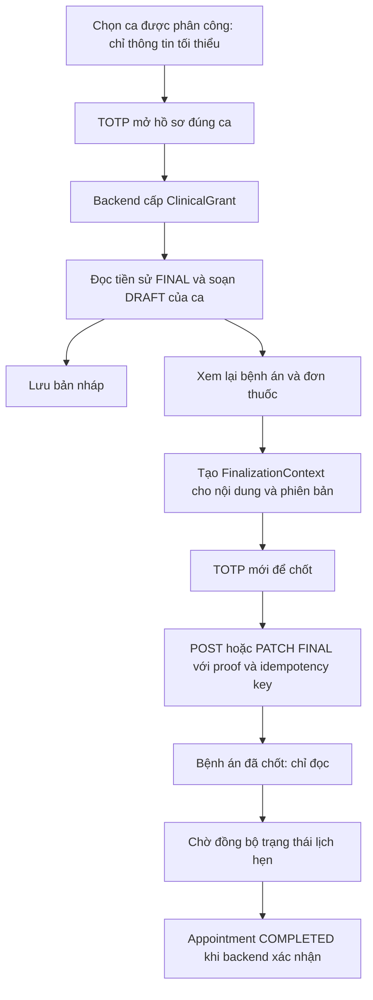

# Đề xuất tổ chức lại UI Clinic Management Web

**Ngày:** 15/11/2026. **Trạng thái:** đề xuất để triển khai; chưa thay đổi giao diện ứng dụng.

Mục tiêu là làm rõ công việc của phòng khám trên từng trang và chuẩn bị giao diện cho API v2. Giữ nhận diện Health&Human, các route và thành phần có ích hiện tại; thay đổi trọng tâm nằm ở thứ tự thông tin, cách nhóm chức năng, trạng thái bảo mật và khả năng phục hồi khi mạng chậm.

## 1. Căn cứ và giới hạn đánh giá

- Frontend: nhánh `feat/m3-ui-acceptance-integrated`, HEAD `b1d3113bd595be6a46071ec20f3d086e369a8e5e`. Backend đối chiếu: `dad4f96aa8d2524c6ce31bee12e6421a5ba44946` trong checkout `backend-openapi`; không merge hay sửa hai nhánh.
- Tài liệu: [API hiện hành](api-contract.md), [API đích v2](api-contract-v2.md), [audit FE–BE](project-audit-report.md), [thiết kế UI được duyệt](ui-design-contract.md), [hợp đồng render/loading](web-rendering-contract.md) và source của các feature liên quan.
- Áp dụng Impeccable để rà tác vụ, thứ bậc thông tin và trạng thái; áp dụng Taste để kiểm tra bố cục, nội dung và ảnh render. Các chỉ dẫn về font, khoảng trống hay chuyển động cho trang quảng bá không thay thế hợp đồng UI của phần mềm phòng khám.
- Chụp giao diện desktop 1440px và mobile 390px bằng Chrome qua script của Taste. `/` và `/auth` chạy frontend thật; các trang bảo vệ dùng dữ liệu mô phỏng, request ghi bị từ chối. Xem [bằng chứng và phạm vi từng ảnh](reviews/2026-11-15-web-ui/README.md).
- Hai lượt rà độc lập bổ sung kiểm tra source và đọc ảnh. Detector Impeccable báo 7 warning, 0 error; hai warning về Inter không áp dụng vì Inter đã được duyệt. Năm warning về viền màu có ngữ nghĩa trạng thái/chưa đọc, không đủ căn cứ để xóa tự động.
- Không có bằng chứng E2E backend/DB thật trong lượt này. Chưa đo đầy đủ contrast, bàn phím, cuộn, trình đọc màn hình hoặc mọi breakpoint; các phần đó nằm trong tiêu chí kiểm chứng khi triển khai.

Phạm vi điều phối tương ứng **TV1 / M2-INTEGRATION-001** ở mức rà hợp đồng chung và tích hợp; đây không phải tuyên bố hoàn thành task M2. Các domain cần đối chiếu với TV2 / M2-USER-001, TV3 / M2-DOCTOR-001 và M2-BOOKING-001/002/003, TV4 / M2-RECORD-001 và M2-NOTIFY-001. Những ID này là tham chiếu registry đã có, không phải task mới tự gán. Theo yêu cầu của người dùng, báo cáo bao phủ toàn web, không giới hạn ở ownership của một thành viên.

## 2. Kết luận về hướng thiết kế

**Nên tổ chức web thành không gian làm việc theo ca khám.** Một ca có danh tính bệnh nhân, thời gian, bác sĩ, trạng thái và hành động tiếp theo; các yếu tố này phải xuất hiện cùng nhau ở chỗ ra quyết định. Dashboard dẫn đến công việc cần làm, lịch hẹn vận hành tiếp đón, hồ sơ khám xử lý nội dung lâm sàng, trang bác sĩ quản lý năng lực tiếp nhận.

Giữ nền sáng, xanh thương hiệu, Inter, bảng gọn và khung điều hướng cố định. Dùng ảnh thật có nguồn phù hợp ở trang giới thiệu nếu có; không đưa ảnh trang trí, hero lớn, chỉ số cho đẹp hoặc animation chào mừng vào màn hình tác nghiệp. Chuyển động chỉ phản hồi thao tác, chuyển trạng thái và tải dữ liệu; hỗ trợ giảm chuyển động.

Điểm nhận diện của sản phẩm nên đến từ tính nhất quán của **ngữ cảnh ca khám và trạng thái xử lý**, thay vì mỗi trang một bộ thẻ và một kiểu tiêu đề.

### Những phần nên giữ

- `/` và `/dashboard` tách riêng; người đã đăng nhập vẫn xem được `/`. Logo đưa về trang chủ, không thêm mục trang chủ vào sidebar dashboard.
- `AppShell`, `PageHeader`, định tuyến theo role, sidebar/topbar cố định và nút thoát luôn tiếp cận được.
- Bảng lịch hẹn desktop: mật độ hiện tại phù hợp, có tên, thời gian, trạng thái bằng chữ và hành động theo quyền.
- Các UI primitives hiện có, màu trạng thái và khả năng giữ input khi lưu bệnh án thất bại.
- Quy tắc skeleton chỉ thay phần dữ liệu, không thay tiêu đề hoặc khung trang.

### Những vấn đề cần giải quyết trước

| Phát hiện | Căn cứ | Hệ quả và hướng sửa |
|---|---|---|
| Lịch hẹn mobile chỉ lộ giờ và cột thao tác; tên bệnh nhân bị khuất | [Ảnh 390px](reviews/2026-11-15-web-ui/appointments-staff-fixture-390.png); cột cuối sticky trong `appointments-panel.module.css` | Không thể quyết định check-in/hủy an toàn từ ngữ cảnh đang thấy. Đổi sang hàng thông tin phù hợp mobile, giữ bệnh nhân + giờ + trạng thái cạnh hành động |
| Chuông thông báo nằm xuống dưới đường phân cách header trên mobile | Cùng ảnh 390px | Sắp lại header mobile; ngày dài chuyển sang dòng phụ, không tranh chỗ với nút điều hướng và tài khoản |
| Hồ sơ khám mở bằng một form trống rất dài, lịch sử ở phía dưới | [Ảnh hồ sơ](reviews/2026-11-15-web-ui/medical-records-doctor-fixture-1440.png) | Chọn ca trước, mở xác minh đúng ca, sau đó mới hiện workspace và tiền sử liên quan |
| Giao diện phiên chỉ có loading/authenticated/unauthenticated; chưa có MFA, khóa phiên và grant lâm sàng | `src/lib/session/session.ts`, `session-context.tsx`, `medical-records-panel.tsx` | Khoảng trống so với **thiết kế đích v2**, chưa thể nghiệm thu v2 bằng việc thêm một hộp nhập mã phía frontend |
| Refresh gặp response lỗi hoặc exception sẽ xóa phiên | `session-context.tsx`, hàm `refreshSession` | Lỗi mạng/503 dễ thành đăng xuất. Phân loại lỗi kết thúc phiên và lỗi tạm thời theo code |
| Lưu FINAL được thông báo là ca đã hoàn thành | `medical-records-panel.tsx`, thông báo sau lưu và banner FINAL | Sai mô hình đồng bộ v2. Tách “Bệnh án đã chốt” khỏi “Lịch hẹn đã hoàn tất” |
| Trang bác sĩ xếp danh sách, form chuyên khoa, form bác sĩ và lịch nối tiếp | [Ảnh bác sĩ](reviews/2026-11-15-web-ui/doctors-admin-fixture-1440.png) | Tác vụ lịch làm việc bị đẩy xa. Tách tab nghiệp vụ, đưa form tạo/sửa ra khỏi luồng xem mặc định |
| Trang cá nhân còn lặp role và nhiều điều khiển chưa hoạt động | [Ảnh hồ sơ cá nhân](reviews/2026-11-15-web-ui/profile-admin-fixture-1440.png); `profile-form.tsx` | Bỏ role của chính mình ngoài header; gộp thông tin, không trình bày avatar/preferences chưa hỗ trợ như chức năng đang dùng |
| Có danh sách lấy giới hạn đầu rồi lọc/tính tổng ở client | Dashboard, bộ chọn ca trong hồ sơ khám; audit FE–BE | Có thể thiếu ca và sai số đếm. Dùng filter/phân trang server, summary v2 khi đã có; không biến lỗi thành 0 |
| “Đánh dấu tất cả” thực tế chỉ xử lý trang thông báo hiện tại | `notifications-panel.tsx`, `unreadOnPage` | Đổi nhãn đúng phạm vi hiện tại; chuyển sang read-all toàn tập khi backend có API mới |
| “Đăng xuất khỏi thiết bị này” chưa khớp provider dùng global sign-out | `profile-form.tsx`; User Service `src/auth.ts` | Chốt và triển khai scope current/all đồng bộ; không chỉ sửa copy để che khác biệt |
| Landing có số liệu, dịch vụ và lời hứa chưa có bằng chứng hoặc API hỗ trợ | [Ảnh trang chủ](reviews/2026-11-15-web-ui/home-live-1440.png); `clinic-landing-page.tsx` | Gỡ/xác minh các claim 99,2%, 30+, 24/7, GPP, QR kiosk, kết quả xét nghiệm… trước phát hành |

## 3. Một khuôn chung cho các trang dashboard

### 3.1 Khung và phân cấp

Thứ tự thống nhất: **tên trang → một câu mô tả tác vụ → thanh công cụ/bộ lọc → vùng nghiệp vụ → phân trang hoặc trạng thái cập nhật**. Không thêm banner chào, role, tiêu đề trang thứ hai hoặc một hàng chỉ số mặc định vào mọi route.

Sidebar desktop giữ chiều rộng 232px và topbar 56px theo hợp đồng. Chỉ vùng nội dung chính cuộn; footer sidebar chứa thoát giữ trong viewport. Khi zoom làm danh sách điều hướng vượt chiều cao, cho vùng nav cuộn độc lập để không mất mục hoặc nút thoát.

Dùng một page frame chung căn giữa. Chọn `.page-stack` hiện có, `max-width: 1050px`, làm baseline đầu tiên để loại bỏ các giới hạn riêng 1100/1120/1200px. Những bảng hoặc workspace thực sự cần rộng hơn chỉ dùng một biến thể rộng dùng chung sau khi kiểm tra dữ liệu thực; không đặt max-width tùy từng feature. Tiêu đề, filter và nội dung của mỗi trang phải cùng cạnh. Form ngắn có thể hẹp bên trong frame đó.

Giữ token trong `globals.css`: `--primary`, `--brand`, `--canvas`, `--surface`, `--surface-subtle`, `--ink`, `--muted`, `--line`, token trạng thái, radius 4/6/8px và thang spacing 4/8px. Theo typography contract: tên trang 24px/600, tiêu đề vùng 18px/600, body 14px/20px. Đưa `PageHeader` hiện đang có cỡ/weight khác về cùng một quy tắc khi triển khai; không tạo một heading component mới.

### 3.2 Header, tên và thuật ngữ

- Header hiển thị tên thật từ profile, một role badge và thông báo. Không dùng DOCTOR/STAFF làm tên dự phòng. Thiếu tên thì hiển thị placeholder trung tính hoặc “Tài khoản”, đồng thời thử lại profile theo trạng thái lỗi.
- Giữ một hàm dịch role dùng chung: DOCTOR = “Bác sĩ”; STAFF = “Nhân viên phòng khám”; ADMIN = “Quản trị viên”. Enum API không đổi.
- Role của **người đang đăng nhập** chỉ xuất hiện ở header sau đăng nhập; bỏ ở lời chào, profile nghề nghiệp, form cá nhân và dòng thiết bị của chính mình. Cột role trong bảng quản lý **các tài khoản** và form đổi role vẫn cần vì đó là dữ liệu nghiệp vụ.
- Trạng thái lịch hẹn dùng chung nhãn: Chờ xác nhận, Đã xác nhận, Đã check-in, Hoàn thành, Đã hủy, Không đến. Bệnh án dùng Bản nháp và Đã chốt. Không dùng “Hoàn thành” cho cả DRAFT/FINAL và trạng thái appointment.
- Ngày giờ hiển thị theo Việt Nam, `dd/MM/yyyy`, `HH:mm`, có UTC+7 ở ngữ cảnh ngày; request dùng ISO UTC. Khoảng ngày gửi `[from,to)` theo ngày Việt Nam. Input ngày native cần kiểm tra locale hoặc kèm nhãn hiển thị rõ, tránh hiểu nhầm tháng/ngày.
- Tên/role có thể phục hồi nhanh từ dữ liệu phiên để trình bày. Cache client không quyết định quyền; Gateway và service vẫn xác minh phiên, role và phạm vi.

### 3.3 Mobile và bàn phím

Ở màn nhỏ, giữ header gọn có menu, thông báo và tài khoản với role một lần; ngày chuyển sang hàng phụ trong nội dung. Drawer đóng không được nhận focus; mở drawer quản lý focus, Escape, trả focus và chặn tương tác vùng phía sau. Không chỉ translate menu ra ngoài màn hình.

Bảng lịch hẹn chuyển sang danh sách gọn theo ca: dòng tên bệnh nhân + định danh phụ được phép; dòng giờ + trạng thái; một hành động chính và nút thao tác khác. Hủy/không đến nằm trong menu có nhãn rõ và bước xác nhận. Bảng desktop giữ nguyên giá trị so sánh nhiều hàng. Lịch làm việc mobile dùng agenda theo ngày; không ép lịch tuần rộng 1080px vào viewport.

Mục tiêu tương tác web tối thiểu 44×44px, gồm nút icon, đóng modal, tab và lọc; có thể giữ phần nhìn gọn với hit area đủ lớn. Input phải có label bền vững, `focus-visible`, hint/error liên kết; placeholder không thay label. Đặc biệt kiểm tra dòng thuốc, input dùng chung đang `outline: none`, focus của drawer và footer hành động không che nội dung khi mở bàn phím.

## 4. Render, skeleton và lỗi: áp dụng cho mọi trang

| Thành phần | Lần tải dữ liệu đầu | Làm mới | Lỗi hoặc thiếu một phần |
|---|---|---|---|
| Shell, tên trang, mô tả tác vụ | Giữ cấu trúc sau khi giải quyết quyền; không bịa tên/role khi chưa biết | Không remount | Giữ khung; lỗi xác thực thật xử lý bằng trạng thái phiên |
| Tiêu đề vùng, nhãn filter, tab, cột bảng | Render cùng component sẽ dùng sau tải | Giữ nguyên | Vẫn hiện để biết chức năng nào bị lỗi |
| Tên bệnh nhân, hàng bảng, số đếm, lịch, giá trị form | Skeleton đúng kích thước vùng dữ liệu | Giữ kết quả hợp lệ của cùng ngữ cảnh, thêm “Đang cập nhật” | Giữ dữ liệu cũ được phép xem + mốc cập nhật; vùng không có dữ liệu hiện lỗi riêng |
| Danh sách rỗng | Chỉ kết luận sau response thành công | Giữ filter | Không dùng empty state hoặc số 0 để che timeout/503 |
| Form đang soạn | Label cố định; field chờ giá trị nếu cần | Không ghi đè field đã sửa | Giữ input, lỗi tại field/vùng lưu và CTA thử lại |
| Thao tác ghi | Busy đúng hàng/nút | Không tự gửi lại | 409 cho đối chiếu; timeout báo chưa xác nhận, không báo thất bại chắc chắn hoặc tạo thao tác mới |

Một header component được dùng xuyên loading/success/empty/error; không viết “header fallback” với nội dung khác. Tránh đặt toàn bộ page dưới một nhánh `if (loading) return ...` hay `if (error) return ...`. Skeleton chỉ là các slot dữ liệu; không shimmer tiêu đề, tên cột hoặc nhãn form.

`aria-busy` theo vùng, một thông báo tiến độ vừa đủ; skeleton trang trí ẩn khỏi accessibility tree. Hỗ trợ reduced motion và tránh đổi chiều cao khung mạnh khi response đến. Mỗi vùng có default/loading/empty/partial/error/refetch; mutation thêm pending/success/conflict/unknown outcome.

Ngoại lệ bảo mật: dữ liệu cũ không được giữ trên màn hình khi phiên khóa/thu hồi hoặc clinical grant mất hiệu lực. Gỡ nội dung nhạy cảm khỏi cây render và ngừng request nghiệp vụ. Bản soạn chưa gửi có thể giữ trong RAM theo actor + ca trong cùng phiên để mở lại sau xác minh hợp lệ; không đưa bệnh án, TOTP secret hoặc grant vào localStorage. Logout/đổi tài khoản/thu hồi phải dọn trạng thái nhạy cảm. Reload có thể làm mất bản nháp chưa lưu; chỉ báo “Đã lưu” khi server xác nhận.

Mọi cache/query phải gắn actor, phạm vi quyền, ca và filter; response cũ không được đè kết quả sau đổi bệnh nhân/filter. Hủy/bỏ qua request hết ngữ cảnh. Gộp refresh phiên và các request trùng, invalidate đúng vùng sau ghi, không reload shell hoặc gọi health của sáu service trên từng trang. Lỗi có requestId ở phần chi tiết hỗ trợ, tránh một banner cao chiếm gần hết màn hình.

## 5. Thiết kế từng trang

### 5.1 `/dashboard` — Tổng quan

**Tác vụ:** tìm công việc tiếp theo trong ngày. Giữ tên “Tổng quan”, mô tả ngắn và ngày đang xem. Không dùng lời chào hoặc role ở thân trang.

| Role | Vùng ưu tiên | Vùng hỗ trợ | Hành động chính |
|---|---|---|---|
| DOCTOR | Ca đã check-in được phân công, tiếp theo là lịch sắp đến | Tóm tắt tiến độ nhỏ; liên kết lịch làm việc | Mở ca → xác minh → khám |
| STAFF | Lịch cần xác nhận, bệnh nhân chờ tiếp đón | Số lượng theo trạng thái đúng ngày, đường vào lịch | Xác nhận / check-in đúng ca |
| ADMIN | Việc vận hành cần xử lý theo dữ liệu đang có | Trạng thái hệ thống nếu tải được; truy cập quản lý tài khoản | Đi đến tác vụ; không mặc định vào bệnh án |

Lấy lịch bằng khoảng ngày rõ ràng, phân trang và phạm vi server. Tóm tắt dùng `/appointments/summary` khi triển khai v2; trước đó không lấy trang đầu 100 item để gọi là tổng toàn hệ thống. Không có nguồn đếm đầy đủ thì chỉ trình bày danh sách/phạm vi đã tải, không tạo KPI.

Tên bệnh nhân lấy summary tối thiểu được phép. Hiện tại dashboard còn rơi về “Bệnh nhân #...” trong fixture; cần read model tên v2 hoặc lookup được phép, không truy vấn profile đầy đủ hàng loạt. Trước clinical grant, bác sĩ không thấy reason, chẩn đoán hay thuốc trong card ca/preview. Mỗi vùng lỗi độc lập: lỗi summary không che danh sách, lỗi danh sách không được báo “không có ca”.

### 5.2 `/appointments` — Quản lý lịch hẹn

**Tác vụ:** theo dõi, tiếp đón và xử lý đúng trạng thái. Đây là baseline bố cục chung.

Phía trên là ngày khám, tìm kiếm, lọc bác sĩ/chuyên khoa khi có nguồn được phép, trạng thái và làm mới. Kế tiếp là bảng: giờ → bệnh nhân → bác sĩ/chuyên khoa → trạng thái → hành động. Ưu tiên tên và định danh phụ đủ phân biệt; không trình bày UUID thô hoặc thông tin BHYT trong danh sách nếu không cần cho tác vụ.

Hành động theo trạng thái và role: STAFF/ADMIN xác nhận PENDING, check-in CONFIRMED, đổi/hủy/không đến theo state machine; DOCTOR chỉ mở ca/xem lịch được phân công. Dùng một nguồn định nghĩa action cho bảng và hàng đợi. Cả xác nhận và check-in phải có ConfirmModal như các hành động còn lại; modal hiển thị tên, ngày giờ, bác sĩ, thay đổi dự kiến.

Đặt hộ tại quầy là một flow trong trang: chọn bệnh nhân → bác sĩ/slot hợp lệ → xem lại → gửi POST appointments. Dùng patient lookup được phép, không yêu cầu nhập UUID. Bộ lọc và phân trang lưu trong URL nếu phù hợp; nội dung lâm sàng không đưa vào URL. Chi tiết ca mở panel để giữ ngữ cảnh danh sách; form dài dùng vùng riêng thay modal quá cao.

`q`, `include=names`, `view`, summary và sort mới chỉ bật khi provider đáp ứng v2. Tìm kiếm toàn tập phải nằm ở server; trong giai đoạn chưa có, nếu giữ tìm cục bộ phải ghi rõ “trong trang hiện tại”, không giấu pagination khi không có kết quả ở trang đang tải. 409 refresh đúng hàng và giữ bộ lọc. Mỗi ý định ghi giữ Idempotency-Key qua retry; slot 409 yêu cầu chọn lại slot, không tự đổi giờ.

Trên mobile áp dụng hàng ca ở mục 3.3. “Bảng” và “Hàng đợi”, nếu giữ cả hai, chỉ khác cách xem cùng dữ liệu/quyền/xác nhận, không trở thành hai triển khai nghiệp vụ song song.

### 5.3 `/doctors` — Bác sĩ và lịch làm việc

**Tác vụ:** biết bác sĩ nào làm việc khi nào, rồi chỉnh đúng đối tượng nếu có quyền.

Đề xuất ba tab trong route hiện tại: **Lịch làm việc · Danh sách bác sĩ · Chuyên khoa**. Lịch là tab mặc định cho tác nghiệp; Chuyên khoa chỉ có chức năng quản lý với ADMIN. STAFF/DOCTOR không nhận form quản trị chỉ bị disabled. Tất cả tab dùng cùng page frame căn giữa.

Tab lịch: chọn bác sĩ, ngày/tuần, lịch làm việc và nghỉ phép; đặt các thao tác tạo/sửa cạnh đối tượng đang xem. DOCTOR ưu tiên lịch của mình; `/doctors/me` là dependency mới để chọn đúng profile, không lấy doctor đầu tiên hoặc dùng userId thay doctorId. Desktop có thể dùng lịch tuần, mobile agenda theo ngày. Phân biệt giờ làm định kỳ, nghỉ phép và slot có thể đặt; không suy ra slot trống chỉ vì chưa tải được occupancy.

Tab bác sĩ: bảng tìm kiếm/phân trang với tên, chuyên khoa, trạng thái và mở hồ sơ nghề nghiệp. ADMIN tạo/sửa bằng form có mục đích; danh mục chuyên khoa tương tự. Bỏ các form quản trị luôn mở nằm giữa danh sách và lịch. Giữ chức năng hiện có bằng cách chuyển vị trí, không xóa chức năng để làm trang ngắn.

Hiện API đã có list/detail/schedule/time-off/available-slots. Cần xử lý đủ pagination time-off. 409 ảnh hưởng lịch hẹn hiển thị số ca bị tác động từ server; không tự hủy ca để lưu lịch mới. Chưa có API xóa nghỉ phép thì không dựng nút xóa hoạt động giả.

### 5.4 `/medical-records` — Hồ sơ khám bệnh

**Tác vụ:** xử lý đúng một ca, đọc tiền sử có quyền, ghi bản nháp và chốt bệnh án/đơn thuốc. Chỉ DOCTOR có workspace lâm sàng.

Trên desktop đủ rộng dùng hai vùng: danh sách ca/chỉ mục hồ sơ gọn và vùng làm việc chính. Trên màn hẹp, danh sách thành bộ chọn; không ép ba cột. Không có ca được chọn thì hiện hướng dẫn chọn ca, không hiện form bệnh án trống dài và thuốc mẫu.

Vùng làm việc có ngữ cảnh bệnh nhân + thời gian + bác sĩ + trạng thái ca; dữ liệu profile đầy đủ chỉ sau grant. Tab **Ca đang khám** chứa form hiện tại và thuốc; **Tiền sử điều trị** là danh sách FINAL có ngày/tác giả, mở read-only sau xác minh. Lịch sử do mình lập có chế độ đọc lại riêng, mặc định tra cứu 6 tháng, không đồng nghĩa xóa hồ sơ cũ hoặc truy cập vô hạn.

Tái sử dụng modal/input cho TOTP nhưng scope challenge theo đúng mục đích. Sau xác minh mở ca, đọc nhiều bệnh án FINAL trong grant còn hạn không hỏi mã cho từng hồ sơ. Ca khác/bệnh nhân khác yêu cầu quyền khác. Hồ sơ FINAL của bác sĩ khác chỉ đọc; không tự mở DRAFT của họ. Quyền đọc lại AUTHORED_HISTORY không mở toàn bộ lịch sử các ca mới của bệnh nhân.

Form giữ label cho triệu chứng, chẩn đoán, ghi chú, kế hoạch; đơn thuốc có tên cột/label bền vững cho tên thuốc, liều, tần suất, thời gian và nút xóa có accessible name. Hai thao tác rõ: **Lưu bản nháp** và **Xem lại và chốt**. Không mặc định chốt khi bấm lưu. Trước chốt, review đầy đủ nội dung và thuốc, xác nhận hậu quả FINAL không sửa trực tiếp; TOTP mới gắn context/version/digest do backend tạo.

Đổi nội dung sau review làm context/proof cũ không còn dùng được. 409 cho xem khác biệt/phiên bản mới, giữ bản đang soạn và yêu cầu xác nhận lại. Timeout sau gửi FINAL là “Chưa xác nhận kết quả”; đối chiếu bằng read/replay idempotent, không phát request chốt mới tự động.

Nếu record đã FINAL nhưng `appointmentCompletion=PENDING`, hiện “Bệnh án đã chốt — đang đồng bộ trạng thái lịch hẹn”; khóa sửa nội dung, không rollback về DRAFT, không gọi public complete để ép thành công. Đổi ca khi còn input chưa lưu cần nhắc lưu/giữ/hủy theo khả năng thật; không tự chuyển bản nháp sang bệnh nhân khác.

Dependency bắt buộc: MFA, access-grants, quyền đọc history, finalization-contexts, version và appointmentCompletion. Đây là triển khai FE–BE đồng bộ; một modal frontend hoặc local flag `verified` không đủ để đưa vào sử dụng theo v2.

### 5.5 `/notifications` — Thông báo

**Tác vụ:** biết sự kiện nào cần xử lý và đi đến đúng ca/hồ sơ. Dùng danh sách một cột có tiêu đề ngắn, thời điểm, nhãn chưa đọc và vùng chi tiết khi chọn; không cần mỗi notification một card cao.

Giữ lọc tất cả/chưa đọc và pagination. Nhãn mark-read đúng phạm vi: API hiện tại xử lý từng item thì bulk của client ghi “Đánh dấu trang này đã đọc”. Chỉ đổi thành “Đánh dấu tất cả đã đọc” khi có read-all v2 với cutoff; badge dùng unread-count toàn tập, không lấy độ dài trang hoặc tự đặt 0 khi request lỗi.

Link mang ID ca/record, không mang chẩn đoán/thuốc trong payload thông báo. Đích kiểm tra lại phiên, quyền và TOTP; notification không phải vé mở bệnh án. IN_APP qua REST và reminder 24h là khả năng hiện có; không quảng bá push, nhắc 1h, email/SMS hoặc preference chưa được hỗ trợ. Giữ danh sách cũ được phép xem khi refetch lỗi và hiện trạng thái cập nhật riêng.

### 5.6 `/profile` — Hồ sơ cá nhân

**Tác vụ:** sửa thông tin của mình và quản lý bảo mật. Thu gọn thành hai nhóm: **Thông tin cá nhân** và **Bảo mật và phiên đăng nhập**; không cần một sidebar phụ bốn mục cho các trang nhiều placeholder.

Thông tin cá nhân có tên, email read-only, số điện thoại, lưu/hủy và trạng thái lưu. Bỏ thẻ avatar lớn nếu chưa có upload, nút “sắp ra mắt”, role read-only, role nghề nghiệp và thông tin cơ sở/mã nhân sự không có nguồn chính thức. Thông tin nghề nghiệp của bác sĩ, nếu cần, lấy đúng Doctor Service và trình bày riêng theo dữ liệu thật.

Bảo mật có thiết lập/trạng thái TOTP, đổi mật khẩu, danh sách phiên/thiết bị và thu hồi khi API tương ứng đã triển khai. Không suy ra “đã bật MFA” từ localStorage. Hiển thị mốc phiên do server trả, phân biệt đăng xuất thiết bị hiện tại và tất cả thiết bị. Tạm thời không hứa scope thiết bị hiện tại khi provider vẫn sign-out global; migration scope là việc chung FE–BE.

Không mở preferences thông báo hoặc switches luôn disabled trong khu vực chức năng chính. Các extension đó được đưa về backlog có nhãn rõ trong tài liệu, không làm sản phẩm trông có tính năng đang hoạt động.

### 5.7 `/users` — Quản lý tài khoản

**Tác vụ:** ADMIN tìm đúng tài khoản và thay đổi quyền/trạng thái có kiểm soát. Bảng gồm tên, email, role, trạng thái và hành động; bộ lọc/search/pagination xử lý server. Không tạo dashboard chỉ số tài khoản nếu chưa có endpoint tổng hợp cần thiết.

Đổi role/khóa/mở khóa dùng một flow review: tài khoản nào, giá trị cũ → mới, hậu quả tới phiên và quyền; sau đó TOTP purpose AUTHORIZE_SENSITIVE_OPERATION và gửi proof đúng payload. Pending/sai mã giữ lựa chọn; đổi payload phải xác minh mới. Không cập nhật role bằng optimistic UI trước server xác nhận.

Role trong bảng tài khoản là dữ liệu cần quản lý nên vẫn hiện; nó không phải role badge lặp của người đăng nhập. ADMIN không được mở bệnh án bằng bảng người dùng. Chức năng tạo/invite nhân sự chưa có trong phạm vi bắt buộc: không dựng CTA hoạt động giả chỉ vì bảng đang thiếu nút tạo.

### 5.8 `/health` — Sức khỏe hệ thống

**Tác vụ:** ADMIN biết kết quả kiểm tra gần nhất còn đáng tin hay không và service nào cần xử lý. Một danh sách sáu thành phần với trạng thái chữ, thời điểm kiểm tra phía client và CTA cập nhật là đủ; không cần chart latency hoặc log console trang trí.

Dùng `/api/v1/system/health` qua Gateway; không gọi cổng từng service từ trình duyệt. Phân biệt: Gateway nhận request được, aggregate degraded, một service unavailable và chưa lấy được báo cáo mới. HTTP 200 của aggregate không có nghĩa toàn bộ service khỏe; một lần request dữ liệu thành công cũng không tự chứng minh readiness DB của mọi service.

Nếu lần kiểm tra mới lỗi thì giữ báo cáo cũ cùng nhãn “Kết quả trước đó”, không tô cả sáu xanh hoặc đổi toàn bộ thành down giả. Có thể cập nhật khi mở trang, người dùng làm mới và polling có nhịp/backoff theo cấu hình đã chốt; pause khi tab ẩn, gộp request. Không ghi một chu kỳ polling mới thành quy định API hoặc hoạt động gia hạn phiên. Các metric outbox/reminder chưa có schema không tự hiển thị.

### 5.9 `/auth` và trạng thái phiên toàn ứng dụng

**Tác vụ:** vào đúng workspace với bảo mật theo role. Giữ form đăng nhập gọn hiện tại, label bền vững và show/hide password. “Ghi nhớ tài khoản” cần nói rõ chỉ nhớ email nếu đó là hành vi thật; không dùng checkbox để tự chọn chính sách phiên trái contract.

| Role/trạng thái | Giao diện cần có |
|---|---|
| DOCTOR đăng nhập hợp lệ | Vào lịch/workspace; phiên idle 15 ngày theo backend. Nội dung lâm sàng vẫn cần xác minh riêng theo ca |
| STAFF/ADMIN sau mật khẩu | PENDING_MFA; enrollment nếu cần, rồi TOTP đầu phiên. Chưa render dữ liệu nghiệp vụ trước ACTIVE |
| STAFF/ADMIN không thao tác 15 phút | LOCKED; gỡ dữ liệu nhạy cảm khỏi render, hiện màn mở khóa TOTP và thoát; giữ bản soạn phù hợp trong RAM |
| STAFF/ADMIN đủ 8 giờ | Hết phiên tuyệt đối; yêu cầu đăng nhập đầy đủ, không chỉ TOTP mở khóa |
| Lỗi mạng/503 khi kiểm tra/refresh | Màn phục hồi kết nối, giữ phiên và bản soạn; không coi là mật khẩu sai hoặc tự xóa credential |
| Phiên hết hạn/thu hồi hoặc tài khoản bị khóa | Chặn nghiệp vụ đúng mã lỗi, dọn dữ liệu theo nguyên nhân, hướng dẫn login/hỗ trợ khi phù hợp |
| PATIENT vào web quản lý | Hướng sang app bệnh nhân; không dựng Patient Web hoặc vô tình global logout các thiết bị khác |

TOTP dùng một input chuỗi sáu số hỗ trợ paste, `inputmode="numeric"`, `autocomplete="one-time-code"`, giữ số 0 đầu và nút xác minh rõ. Không dùng sáu ô tự nhảy làm khó bàn phím. Có lỗi sai mã, challenge hết hạn, giới hạn thử và dependency unavailable riêng. QR/secret chỉ ở enrollment, không lưu/log; mất factor cần recovery được chốt, không có nút “bỏ qua bảo mật”.

Khóa/thu hồi/đổi tài khoản phải đồng bộ các tab và cache nhạy cảm; một tab đang mở không được tiếp tục dùng dữ liệu sau khóa. Polling, refresh token và nhận thông báo không tự tính là người dùng hoạt động. Sau mở khóa không tự submit form trước đó. Trang quên/đổi mật khẩu chỉ bật với route recovery v2 đã hoạt động; không nối trực tiếp frontend vào Supabase.

### 5.10 `/` — Trang giới thiệu phòng khám

**Tác vụ:** hiểu phòng khám cung cấp gì và tìm đường tiếp cận thật. Đây là trang có thể vận dụng Taste về copy và ảnh, vẫn giữ nhận diện đã duyệt.

Đề xuất nội dung: tên phòng khám + mô tả ngắn có nguồn; dịch vụ đã xác minh; quy trình đặt khám trên ứng dụng bệnh nhân; địa chỉ/giờ mở cửa/liên hệ đã duyệt; đăng nhập nội bộ hoặc trở lại dashboard nếu đang đăng nhập. Tránh h1 nhiều dòng viết hoa từng từ và sáu nhóm card lặp cùng một kiểu. Ảnh phòng khám/đội ngũ dùng khi có quyền sử dụng và không ngụ ý ảnh stock là nhân sự thật.

Gỡ hoặc xác minh các số liệu trải nghiệm/hài lòng, chứng nhận GPP, cấp cứu 24/7, đánh giá bác sĩ, lịch trống mẫu, địa chỉ/điện thoại và bài viết gán tên tác giả. FAQ chỉ mô tả tính năng đang cung cấp, không hứa kiosk/QR, bảo hiểm, xét nghiệm hay PDF chưa có. Không biến dữ liệu mẫu thành bằng chứng uy tín của cơ sở.

API doctor/specialty hiện yêu cầu phiên ACTIVE. Vì vậy không thể ghép danh sách mẫu vào ô “tìm bác sĩ” rồi gọi là catalogue trực tiếp. Nếu cần catalogue public phải quyết định endpoint/read model công khai riêng trước; không mở quyền anonymous cho toàn bộ API bảo vệ. Hiện tại dùng nội dung tĩnh đã duyệt và đường dẫn ứng dụng thật. Chỉ có nút tải/QR/deep link khi đã có đích hợp lệ; không viết Flutter/Android framework như lợi ích dành cho bệnh nhân.

## 6. Ma trận UI ↔ API để phát triển song song

`CÓ` dưới đây là có route ở snapshot đã đối chiếu, không chứng minh đã đạt toàn bộ semantics v2 hay đang chạy tốt. Mọi đường dẫn đều qua Gateway với prefix `/api/v1`; số v2 của tài liệu không tự đổi prefix.

| Bề mặt UI | API dùng được về mặt danh mục | Phần đích mới/thay đổi cần backend đồng bộ | Quy tắc trước khi provider sẵn sàng |
|---|---|---|---|
| Header/profile | GET/PATCH `/users/me`; login/refresh | Metadata session theo role; có thể mở rộng fullName chính thức trong auth response | Tên từ profile; cache chỉ phục vụ trình bày, không giả ACTIVE/MFA |
| Auth/khóa/bảo mật | POST `/auth/login`, `/auth/refresh`, `/auth/logout` | `/auth/session`, `/auth/session/activity`, MFA enroll/factors/challenges/verify, danh sách/thu hồi phiên, password/recovery; logout current/all | Có thể thiết kế component bằng fixture; chưa công bố đạt bảo mật v2 |
| Dashboard/lịch hẹn | GET/POST `/appointments`, GET detail, PATCH transition/reschedule/cancel | `/appointments/summary`, q/include=names/view/sort, bảo vệ field trước grant và idempotency bổ sung | Không giả tổng toàn tập; giới hạn và copy tìm kiếm phải đúng khả năng |
| Bác sĩ/lịch | `/doctors`, `/specialties`, schedules, time-offs, available-slots | `/doctors/me`; conflict/dependency semantics và đủ phân trang theo v2 | Dùng ID đã xác định đúng, không lấy doctor bất kỳ; không giả slot trống |
| Hồ sơ khám | GET/POST/PATCH `/medical-records` và detail | Clinical grants, finalization contexts, proof, version, scoped history, appointmentCompletion | Không dùng frontend-only MFA hoặc fallback bỏ grant/proof |
| Thông báo | GET list/detail, PATCH từng item/read | unread-count, read-all với cutoff | Nhãn “trang này” nếu chỉ thao tác trang đang tải |
| Tài khoản | GET `/users`, detail; PATCH role/status | Proof xác minh nhạy cảm, invalidation phiên/quyền | Không phát hành v2 nếu chỉ thay giao diện modal mà backend không enforce |
| Health | GET `/system/health`, `/health` | Không cần endpoint mới chỉ để đổi bố cục | Không suy ra DB health bằng một request login thành công |
| Landing public | Không có catalogue bác sĩ anonymous được duyệt | Catalogue public nếu có yêu cầu mới; link tải app đã xác minh | Không dùng sample availability/ratings làm dữ liệu thật |

Định nghĩa type và fixture theo OpenAPI/contract đích cho phần chưa triển khai, đánh dấu rõ development-only. Tách trạng thái provider chưa sẵn sàng khỏi lỗi mạng. Không có chế độ fallback âm thầm gửi request v1 thiếu kiểm tra v2 để “cho UI chạy được”.

## 7. Tái sử dụng thành phần và tránh phình dự án

| Thành phần hiện có | Cách dùng thống nhất |
|---|---|
| `AppShell`, route registry, `PageHeader` | Một shell, một nguồn title/subtitle, một mapping role/nhãn; frame chung |
| `Button`, `Input`/`TextInput`, `Modal`, `ConfirmModal`, `Alert`, `Badge` | Sửa focus/hit area/trạng thái chung; không viết bộ nút/dialog riêng cho từng trang |
| `Skeleton`, `SkeletonTable`, state components, `Pagination` | Skeleton slot dữ liệu và lỗi theo vùng, không tạo thêm một phiên bản header trong fallback |
| `StatusBadge`, định nghĩa action lịch hẹn | Dùng chung bảng, dashboard và hàng đợi; không lặp state machine trong JSX |
| Appointment/patient selector, prescription form | Cùng nguồn tên/phạm vi, phân trang thật, label bền vững; truyền ngữ cảnh ca có kiểm tra |

Phần cần bổ sung có mục đích: một component xác minh TOTP tái sử dụng theo purpose; một màn khóa phiên; một gate quyền lâm sàng theo ca; một bước review/chốt gắn finalization context. Đây là **component đề xuất mới**, không phải mô tả những gì đã tồn tại. Dùng primitives hiện có, không thêm UI library/animation engine hoặc service mới.

API client cần giữ error code để điều hướng theo AUTH_SESSION_LOCKED, MFA/clinical verification, ACCESS_DENIED, 409 và 503; không ép mọi 403 thành một câu “không có quyền”. Session refresh phải gộp request và chỉ xóa phiên khi lỗi thực sự kết thúc phiên hoặc người dùng chủ động thoát.

## 8. Thứ tự thực hiện và tiêu chí nghiệm thu

### Đợt 1 — Đồng nhất và sửa vấn đề dùng được ngay

Chỉnh frame/heading chung, mobile shell và lịch hẹn; bỏ role lặp/placeholder chức năng cá nhân; chuẩn hóa label, focus và hit area; sửa copy mark-read và trạng thái chốt; thống nhất confirm/check-in. Đối chiếu provider trước đổi copy logout. Giữ dữ liệu/phiên khi lỗi tạm thời, không thay API để bỏ guard.

Nghiệm thu: chuyển các route có cùng cạnh title/filter/body; refresh không đổi tên heading hoặc skeleton cả trang; mobile luôn thấy bệnh nhân/giờ/trạng thái trước khi tác động; drawer đóng không focus được; dữ liệu lỗi không biến thành empty/0; role người đang dùng chỉ một lần ở header.

### Đợt 2 — Một luồng FE–BE v2 hoàn chỉnh

Triển khai lát cắt: phiên và MFA → lịch hẹn có summary tối thiểu → chọn ca → grant → đọc tiền sử → lưu DRAFT → review/context → TOTP mới → FINAL → đồng bộ COMPLETED → thông báo. Tách UI fixture khỏi chế độ dùng thật. Rollout schema/consumer phối hợp, không bật MFA/grant nửa vời.

Nghiệm thu bằng request thật qua Gateway và DB test được phép: sai role/ca/patient bị chặn; không mở dữ liệu trước grant; proof khác payload/hết hạn/replay bị từ chối; 409 và timeout giữ input; chốt không nhân đôi record/thuốc/event; trạng thái FINAL/PENDING/COMPLETED hiển thị đúng. Không đánh dấu đạt chỉ vì screenshot hoặc mock test chạy xanh.

### Đợt 3 — Hoàn thiện các vùng quản lý và nội dung public

Tách tab bác sĩ/lịch/chuyên khoa, hoàn thiện phiên/thiết bị và thao tác tài khoản nhạy cảm, unread count/read-all, health theo độ mới dữ liệu; biên tập landing dựa trên thông tin có bằng chứng. Chỉ bổ sung extension như PDF, QR kiosk, push và invite khi đã chốt API/scope.

Nghiệm thu mỗi feature với dữ liệu nhiều hơn một trang, empty/partial/503, filter và timezone; không cắt cứng 20/100 item. Kiểm tra 390/768/1440px, zoom 200%, bàn phím, focus modal/drawer, reduced motion, contrast theo WCAG 2.1 AA và content không bị fixed bars che. Từng lượt chỉ chạy các check phù hợp thay đổi và ghi kết quả thật.

### Những quyết định còn phải chốt

Không hỏi lại các mốc đã thống nhất: PATIENT idle 30 ngày, DOCTOR idle 15 ngày, STAFF/ADMIN 8 giờ và khóa 15 phút. Các điểm còn mở của API v2 mục 17 gồm trạng thái/cửa sổ được mở ca, TTL grant và khóa quyền lâm sàng, cửa sổ đọc lại 1 hay 2 năm và ảnh hưởng chuyển cơ sở, expiry/rate limit MFA và khôi phục mất factor. Thiết kế chừa trạng thái tương ứng, không tự gán số hoặc mở quyền vô hạn.

Cần hòa giải tài liệu UI cũ trước triển khai v2: mục 14.1 vẫn gọi lịch hẹn là placeholder; mục 14.2 mô tả staff xem bệnh án, ca đã hoàn tất và reset form sau lưu; sidebar/profile còn mô tả role ở thân trang. Những mô tả đó không khớp source mới, yêu cầu người dùng và API đích. Giữ nguyên các token được duyệt; sửa đặc tả quyền/quy trình cùng thay đổi triển khai, không dùng đoạn cũ để vượt kiểm tra bảo mật.

## 9. Phạm vi bàn giao của lượt rà này

Đã đối chiếu source và hợp đồng, chụp chín ảnh giao diện, ghi nhận phát hiện có căn cứ và đề xuất bố cục/trạng thái từng route. Chưa sửa component, backend, env hay contract đã duyệt; chưa thực hiện commit, triển khai hoặc kiểm thử tích hợp thật. Ưu tiên tiếp theo là khung chung và lịch hẹn mobile, đồng thời chuẩn bị lát cắt xác minh–khám–chốt theo API v2.
